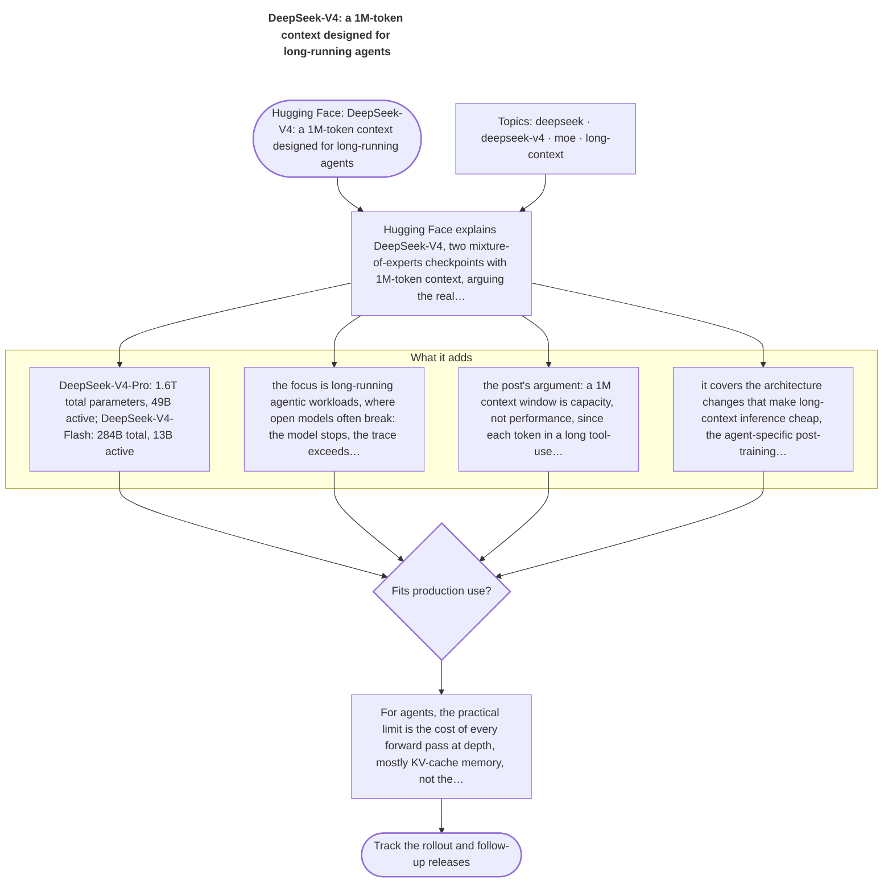

## What happened

On 24 April 2026 **Hugging Face** published its analysis of **DeepSeek-V4**, released that day with two MoE checkpoints on the Hub, both with a **1M-token** context window.

## The technical details

From the Hugging Face post:

- **DeepSeek-V4-Pro:** 1.6T total parameters, 49B active; **DeepSeek-V4-Flash:** 284B total, 13B active
- the focus is **long-running agentic workloads**, where open models often break: the model stops, the trace exceeds the context budget, the **KV cache fills the GPU**, or tool-call round trips degrade partway through a task
- the post's argument: **a 1M context window is capacity, not performance**, since each token in a long tool-use trajectory pays attention cost against everything before it
- it covers the **architecture changes that make long-context inference cheap**, the **agent-specific post-training decisions**, and takeaways from the paper

## How it fits together

The flowchart below maps this announcement's main points and what depends on them.

## Why it matters

For agents, the practical limit is the cost of every forward pass at depth, mostly KV-cache memory, not the advertised window. That is why the post looks at efficiency rather than leaderboard scores.
