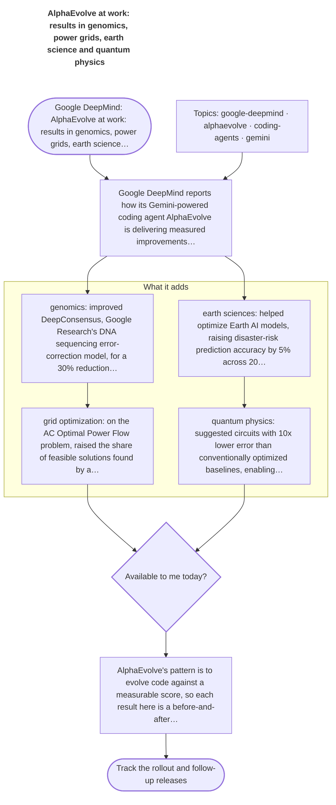

## What happened

On 6 May 2026 **Google DeepMind** published an overview of the impact of **AlphaEvolve**, its Gemini-powered coding agent, across scientific and engineering domains.

## The technical details

From the Google DeepMind post:

- **genomics:** improved **DeepConsensus**, Google Research's DNA sequencing error-correction model, for a **30% reduction in variant detection errors**, used by scientists at PacBio
- **grid optimization:** on the **AC Optimal Power Flow** problem, raised the share of feasible solutions found by a graph neural network from **14% to over 88%**, reducing costly post-processing
- **earth sciences:** helped optimize Earth AI models, raising disaster-risk prediction accuracy by **5%** across 20 categories such as wildfires, floods and tornadoes
- **quantum physics:** suggested circuits with **10x lower error** than conventionally optimized baselines, enabling complex molecular simulations on Google's **Willow** quantum processor

## How it fits together

The flowchart below maps this announcement's main points and what depends on them.

## Why it matters

AlphaEvolve's pattern is to evolve code against a measurable score, so each result here is a before-and-after number in a different domain. That is the useful way to read the post: improvement on a stated metric, reported by the team that built the agent.
