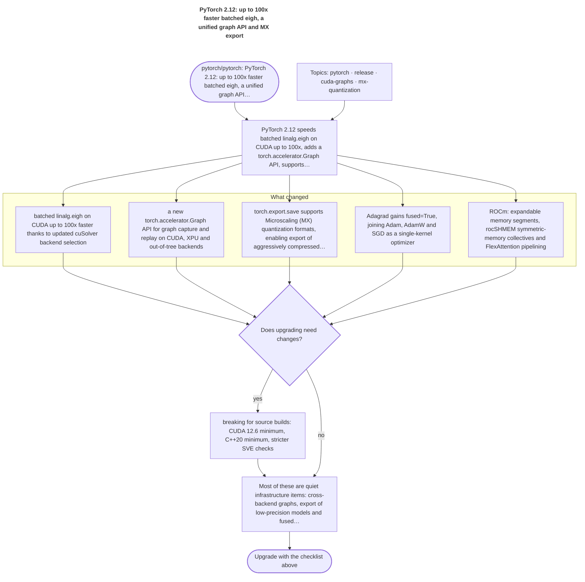

## What happened

On 13 May 2026 the **PyTorch** team released **2.12.0**.

## The technical details

From the release notes:

- batched **`linalg.eigh` on CUDA up to 100x faster** thanks to updated cuSolver backend selection
- a new **`torch.accelerator.Graph`** API for graph capture and replay on CUDA, XPU and out-of-tree backends
- **`torch.export.save`** supports **Microscaling (MX)** quantization formats, enabling export of aggressively compressed models
- **Adagrad** gains `fused=True`, joining Adam, AdamW and SGD as a single-kernel optimizer
- **ROCm:** expandable memory segments, rocSHMEM symmetric-memory collectives and FlexAttention pipelining
- breaking for source builds: CUDA 12.6 minimum, C++20 minimum, stricter SVE checks

## How it fits together

The flowchart below maps this announcement's main points and what depends on them.

## Why it matters

Most of these are quiet infrastructure items: cross-backend graphs, export of low-precision models and fused optimizers. Together they show PyTorch treating non-NVIDIA backends and low-precision formats as part of the core.
