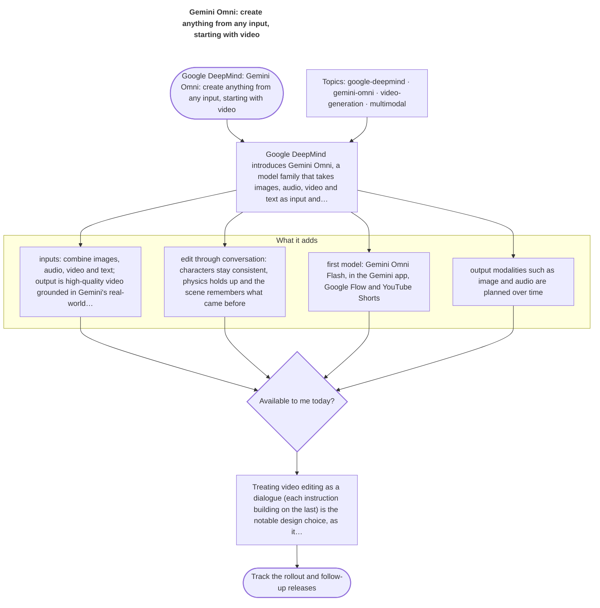

## What happened

On 17 May 2026 **Google DeepMind** introduced **Gemini Omni**, described as the point where Gemini's ability to reason meets the ability to create. It follows Nano Banana, which brought Gemini to image generation and editing.

## The technical details

From the Google DeepMind post:

- **inputs:** combine images, audio, video and text; output is **high-quality video grounded in Gemini's real-world knowledge**
- **edit through conversation:** characters stay consistent, physics holds up and the scene remembers what came before
- first model: **Gemini Omni Flash**, in the **Gemini app, Google Flow and YouTube Shorts**
- output modalities such as **image and audio** are planned over time

## How it fits together

The flowchart below maps this announcement's main points and what depends on them.

## Why it matters

Treating video editing as a dialogue (each instruction building on the last) is the notable design choice, as it keeps a coherent scene across revisions. Positioning Omni as a family that will add other outputs suggests a single generator for all media rather than separate tools.
