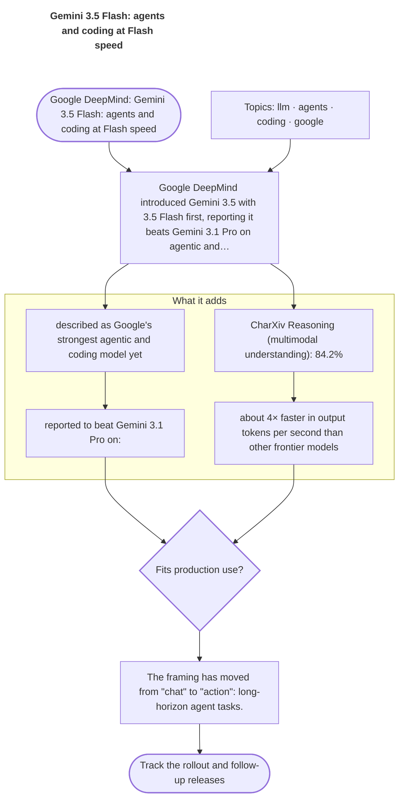

## What happened

Google DeepMind introduced **Gemini 3.5**, starting with **3.5 Flash**, available in the Gemini app, AI Mode in Search, Google Antigravity, the Gemini API and enterprise products. **3.5 Pro** was said to be in internal use and due the next month. The page is dated 19 May 2026.

## The technical details

From the post:

- described as Google's **strongest agentic and coding model yet**
- reported to beat **Gemini 3.1 Pro** on:
  - **Terminal-Bench 2.1**: 76.2%
  - **GDPval-AA**: 1656 Elo
  - **MCP Atlas**: 83.6%
- **CharXiv Reasoning** (multimodal understanding): 84.2%
- about **4× faster** in output tokens per second than other frontier models

## How it fits together

The flowchart below maps this announcement's main points and what depends on them.

## Why it matters

The framing has moved from "chat" to "action": long-horizon agent tasks. An MCP-based benchmark in a launch post shows how quickly MCP (my September 2026 study post) became standard plumbing.
