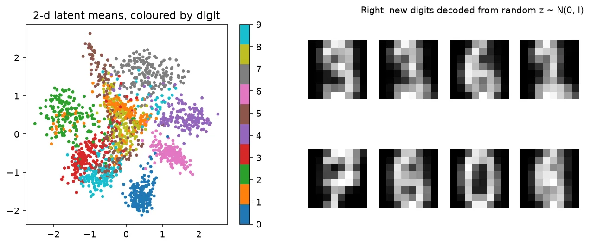

Phase 14 is generative models. The first one: the **variational autoencoder** (Kingma and Welling, 2013).

A plain autoencoder squeezes an input into a code and reconstructs it, but its code space has holes: decoding a random point gives garbage. A VAE fixes this by making the encoder output a **distribution**:

- the encoder gives μ and log σ² for each latent dimension
- **reparameterisation**: sample z = μ + σ·ε with ε ~ N(0, I), so the sampling step is differentiable
- the loss is **reconstruction + KL(q(z|x) ‖ N(0, I))**; the KL term pulls every code toward a standard normal, so the space is smooth and filled in
- **to generate**: sample z ~ N(0, I) and decode

I trained a small MLP VAE (2-d latent, so it can be plotted) on scikit-learn's 8×8 digits.

```python run
import os, numpy as np, torch, torch.nn as nn, torch.nn.functional as F
import matplotlib.pyplot as plt
from sklearn.datasets import load_digits
torch.manual_seed(0); torch.set_num_threads(4)

X, y = load_digits(return_X_y=True)
X = torch.tensor(X / 16.0, dtype=torch.float32)

class VAE(nn.Module):
    def __init__(self, z=2):
        super().__init__()
        self.enc = nn.Sequential(nn.Linear(64, 128), nn.ReLU())
        self.mu, self.logvar = nn.Linear(128, z), nn.Linear(128, z)
        self.dec = nn.Sequential(nn.Linear(z, 128), nn.ReLU(), nn.Linear(128, 64), nn.Sigmoid())
    def forward(self, x):
        h = self.enc(x); mu, logvar = self.mu(h), self.logvar(h)
        z = mu + torch.exp(0.5 * logvar) * torch.randn_like(mu)          # reparameterisation
        return self.dec(z), mu, logvar

vae = VAE(); opt = torch.optim.Adam(vae.parameters(), lr=2e-3)
for epoch in range(150):
    for i in range(0, len(X), 128):
        xb = X[i:i + 128]
        rec, mu, logvar = vae(xb)
        recon = F.binary_cross_entropy(rec, xb, reduction="sum") / len(xb)
        kl = -0.5 * torch.sum(1 + logvar - mu ** 2 - logvar.exp()) / len(xb)
        opt.zero_grad(); (recon + kl).backward(); opt.step()
    if epoch % 50 == 0 or epoch == 149:
        print(f"epoch {epoch:>3}: reconstruction {recon.item():6.2f} | KL {kl.item():.2f}")

with torch.no_grad():
    mu = vae.mu(vae.enc(X)).numpy()
    samples = vae.dec(torch.randn(8, 2)).reshape(-1, 8, 8)
fig = plt.figure(figsize=(11, 4), dpi=140)
ax = fig.add_subplot(1, 2, 1); sc = ax.scatter(mu[:, 0], mu[:, 1], c=y, cmap="tab10", s=6)
ax.set_title("2-d latent means, coloured by digit"); fig.colorbar(sc, ax=ax)
for k in range(8):
    a = fig.add_subplot(2, 8, 5 + (k // 4) * 8 + k % 4); a.imshow(samples[k], cmap="gray"); a.axis("off")
fig.suptitle("Right: new digits decoded from random z ~ N(0, I)", x=0.75, y=0.95, fontsize=10)
fig.savefig(os.environ["SNIPPET_FIG"], bbox_inches="tight")
```

Output:

```text
epoch   0: reconstruction  29.83 | KL 1.49
epoch  50: reconstruction  21.23 | KL 1.79
epoch 100: reconstruction  22.06 | KL 2.08
epoch 149: reconstruction  22.22 | KL 2.23
```


