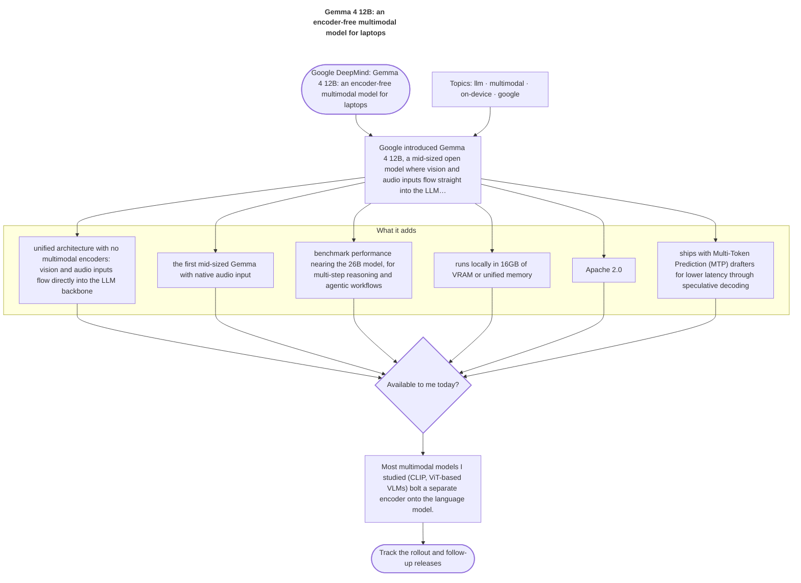

## What happened

Google DeepMind introduced **Gemma 4 12B** (the page is dated 3 June 2026), between the edge-friendly E4B and the larger 26B MoE. The post says Gemma 4 models had crossed **150 million downloads**.

## The technical details

From the post:

- **unified architecture with no multimodal encoders**: vision and audio inputs flow directly into the LLM backbone
- the first mid-sized Gemma with **native audio input**
- benchmark performance **nearing the 26B** model, for multi-step reasoning and agentic workflows
- runs locally in **16GB** of VRAM or unified memory
- **Apache 2.0**
- ships with **Multi-Token Prediction (MTP) drafters** for lower latency through speculative decoding

## How it fits together

The flowchart below maps this announcement's main points and what depends on them.

## Why it matters

Most multimodal models I studied (CLIP, ViT-based VLMs) bolt a separate encoder onto the language model. Dropping the encoder is the "early fusion" direction (Chameleon, Emu3, Llama 4) reaching a laptop-sized open model.
