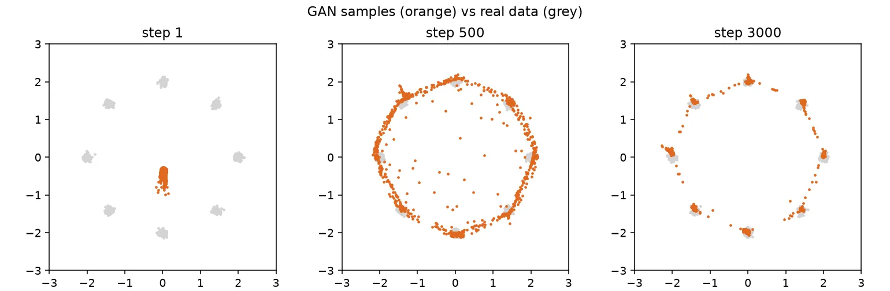

A **GAN** (Goodfellow et al., 2014) trains two networks against each other:

- the **generator** G(z) turns random noise into fake samples
- the **discriminator** D(x) outputs the probability that x is real

$$\min_G \max_D \; \mathbb{E}_{x}[\log D(x)] + \mathbb{E}_{z}[\log(1 - D(G(z)))]$$

In practice G is trained with the "non-saturating" loss (maximise log D(G(z))), which the original paper recommends because it gives stronger gradients early on.

GANs are famous for unstable training and **mode collapse**, where the generator produces only part of the data's variety. My [DCGAN reproduction repo](/2026/03/28/built-modern-dcgan-reproducibility/) from March swaps in LSGAN loss and spectral normalisation for exactly this reason.

The classic toy problem: 8 Gaussians arranged in a ring. A good generator should hit all 8.

```python run
import os, math, torch, torch.nn as nn
import matplotlib.pyplot as plt
torch.manual_seed(0); torch.set_num_threads(4)

centres = torch.tensor([[math.cos(2 * math.pi * k / 8), math.sin(2 * math.pi * k / 8)] for k in range(8)]) * 2
def real(n): return centres[torch.randint(0, 8, (n,))] + 0.05 * torch.randn(n, 2)

G = nn.Sequential(nn.Linear(2, 128), nn.ReLU(), nn.Linear(128, 128), nn.ReLU(), nn.Linear(128, 2))
D = nn.Sequential(nn.Linear(2, 128), nn.LeakyReLU(0.2), nn.Linear(128, 128), nn.LeakyReLU(0.2), nn.Linear(128, 1))
optG, optD = torch.optim.Adam(G.parameters(), 1e-3, betas=(0.5, 0.999)), torch.optim.Adam(D.parameters(), 1e-3, betas=(0.5, 0.999))
bce = nn.BCEWithLogitsLoss()

def modes_covered(n=2000):
    with torch.no_grad():
        fake = G(torch.randn(n, 2))
    nearest = torch.cdist(fake, centres).argmin(1)
    close = torch.cdist(fake, centres).min(1).values < 0.3
    return len(set(nearest[close].tolist())), close.float().mean().item()

snapshots = {}
for step in range(1, 3001):
    x, z = real(256), torch.randn(256, 2)
    lossD = bce(D(x), torch.ones(256, 1)) + bce(D(G(z).detach()), torch.zeros(256, 1))
    optD.zero_grad(); lossD.backward(); optD.step()
    lossG = bce(D(G(torch.randn(256, 2))), torch.ones(256, 1))      # non-saturating generator loss
    optG.zero_grad(); lossG.backward(); optG.step()
    if step in (1, 500, 3000):
        m, frac = modes_covered()
        print(f"step {step:>4}: D loss {lossD.item():.3f} | G loss {lossG.item():.3f} | modes hit {m}/8 | samples near a mode {frac:.0%}")
        with torch.no_grad(): snapshots[step] = G(torch.randn(1000, 2))

fig, axs = plt.subplots(1, 3, figsize=(11, 3.6), dpi=140)
for ax, (s, pts) in zip(axs, snapshots.items()):
    ax.scatter(*real(1000).T, s=2, c="lightgray"); ax.scatter(*pts.T, s=2, c="#e0681f")
    ax.set_title(f"step {s}"); ax.set_xlim(-3, 3); ax.set_ylim(-3, 3); ax.set_aspect("equal")
fig.suptitle("GAN samples (orange) vs real data (grey)"); fig.tight_layout(); fig.savefig(os.environ["SNIPPET_FIG"])
```

Output:

```text
step    1: D loss 1.368 | G loss 0.712 | modes hit 0/8 | samples near a mode 0%
step  500: D loss 1.233 | G loss 0.847 | modes hit 8/8 | samples near a mode 68%
step 3000: D loss 1.372 | G loss 0.747 | modes hit 8/8 | samples near a mode 96%
```


