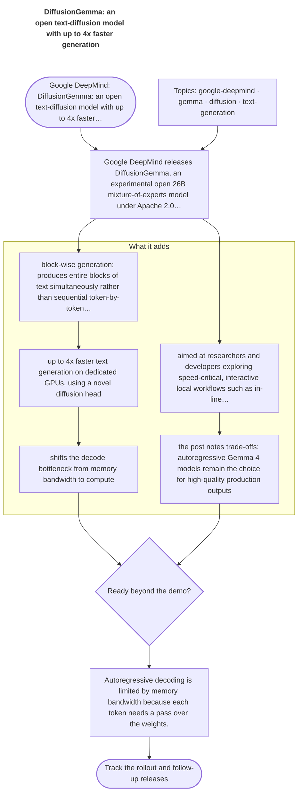

## What happened

On 10 June 2026 **Google DeepMind** introduced **DiffusionGemma**, an experimental open model that explores text diffusion, released under an Apache 2.0 license. It is a **26B Mixture of Experts** model built on the Gemma 4 family and Gemini Diffusion research.

## The technical details

From the Google DeepMind post:

- **block-wise generation:** produces entire blocks of text simultaneously rather than sequential token-by-token decoding
- up to **4x faster text generation** on dedicated GPUs, using a novel **diffusion head**
- **shifts the decode bottleneck from memory bandwidth to compute**
- aimed at researchers and developers exploring speed-critical, interactive local workflows such as **in-line editing, rapid iteration and generating non-linear text structures**
- the post notes trade-offs: autoregressive Gemma 4 models remain the choice for high-quality production outputs

## How it fits together

The flowchart below maps this announcement's main points and what depends on them.

## Why it matters

Autoregressive decoding is limited by memory bandwidth because each token needs a pass over the weights. Diffusing blocks in parallel turns that into a compute-bound job, which is why it helps local interactive uses where latency dominates.
