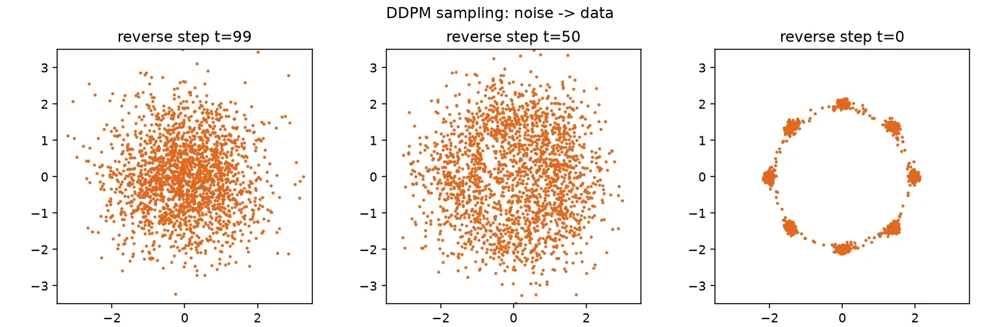

**Diffusion models** (Sohl-Dickstein et al., 2015; DDPM by Ho, Jain and Abbeel, 2020) generate by learning to undo noise:

- **forward process** (fixed, no learning): over T steps, mix data with Gaussian noise until it's pure noise. There's a closed form for jumping to any step: $x_t = \sqrt{\bar\alpha_t}\,x_0 + \sqrt{1-\bar\alpha_t}\,\epsilon$.
- **training**: pick a random t, noise x₀ to x_t, and train a network ε_θ(x_t, t) to **predict ε**. It's just MSE, which the DDPM paper found to work well (their "simplified objective").
- **sampling**: start from pure noise and apply the learned reverse step T times.

Compared with GANs there's no adversarial game, so training is stable. The cost is many network calls per sample.

I used the same 8-Gaussian ring as the GAN post, so the two can be compared.

```python run
import os, math, torch, torch.nn as nn
import matplotlib.pyplot as plt
torch.manual_seed(0); torch.set_num_threads(4)

centres = torch.tensor([[math.cos(2 * math.pi * k / 8), math.sin(2 * math.pi * k / 8)] for k in range(8)]) * 2
def real(n): return centres[torch.randint(0, 8, (n,))] + 0.05 * torch.randn(n, 2)

T = 100
betas = torch.linspace(1e-4, 0.05, T)
alphas = 1 - betas; abar = torch.cumprod(alphas, 0)

net = nn.Sequential(nn.Linear(3, 256), nn.SiLU(), nn.Linear(256, 256), nn.SiLU(), nn.Linear(256, 2))
eps_model = lambda x, t: net(torch.cat([x, (t.float() / T).unsqueeze(1)], 1))
opt = torch.optim.Adam(net.parameters(), 2e-3)
for step in range(4000):
    x0 = real(512); t = torch.randint(0, T, (512,)); eps = torch.randn_like(x0)
    xt = abar[t].sqrt().unsqueeze(1) * x0 + (1 - abar[t]).sqrt().unsqueeze(1) * eps
    loss = ((eps_model(xt, t) - eps) ** 2).mean()
    opt.zero_grad(); loss.backward(); opt.step()
print("final noise-prediction MSE:", round(loss.item(), 4))

@torch.no_grad()
def sample(n):
    x = torch.randn(n, 2); keep = {}
    for t in reversed(range(T)):
        tt = torch.full((n,), t)
        x = (x - betas[t] / (1 - abar[t]).sqrt() * eps_model(x, tt)) / alphas[t].sqrt()
        if t > 0: x = x + betas[t].sqrt() * torch.randn_like(x)
        if t in (99, 50, 0): keep[t] = x.clone()
    return keep

snaps = sample(2000)
final = snaps[0]
d = torch.cdist(final, centres).min(1)
print(f"modes hit: {len(set(torch.cdist(final, centres).argmin(1)[d.values < 0.3].tolist()))}/8 | samples near a mode: {(d.values < 0.3).float().mean():.0%}")

fig, axs = plt.subplots(1, 3, figsize=(11, 3.6), dpi=140)
for ax, t in zip(axs, (99, 50, 0)):
    ax.scatter(*snaps[t].T, s=2, c="#e0681f"); ax.set_title(f"reverse step t={t}")
    ax.set_xlim(-3.5, 3.5); ax.set_ylim(-3.5, 3.5); ax.set_aspect("equal")
fig.suptitle("DDPM sampling: noise -> data"); fig.tight_layout(); fig.savefig(os.environ["SNIPPET_FIG"])
```

Output:

```text
final noise-prediction MSE: 0.392
modes hit: 8/8 | samples near a mode: 96%
```


