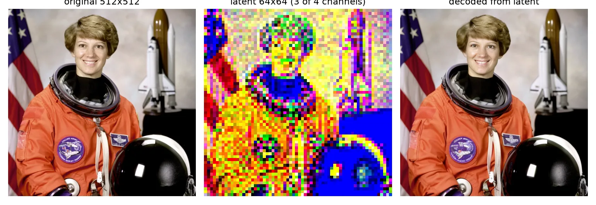

Pixel-space diffusion at 512×512 is very expensive. **Latent diffusion** (Rombach et al., 2021), the basis of **Stable Diffusion**, splits the job in two:

1. A **VAE** compresses an image into a small **latent** (512×512×3 → 4×64×64) and decodes latents back to pixels.
2. The **diffusion U-Net** works only on latents, conditioned on text through cross-attention to text-encoder embeddings.
3. At generation time: start from latent noise, denoise for N steps (with classifier-free guidance, next posts), then decode once with the VAE.

A full text-to-image run is too slow for my CPU snippets, but the VAE half isn't. I ran the real Stable Diffusion VAE (`stabilityai/sd-vae-ft-mse`) on the public-domain NASA astronaut photo from scikit-image, measured the compression, and checked how much detail survives the round trip.

```python run
import os, numpy as np, torch
import matplotlib.pyplot as plt
from diffusers import AutoencoderKL
from skimage import data
torch.set_num_threads(4)

vae = AutoencoderKL.from_pretrained("stabilityai/sd-vae-ft-mse").eval()
img = torch.tensor(data.astronaut()[:, :, :3], dtype=torch.float32).permute(2, 0, 1)[None] / 127.5 - 1   # 512x512, [-1, 1]
with torch.no_grad():
    latent = vae.encode(img).latent_dist.mean
    recon = vae.decode(latent).sample.clamp(-1, 1)

print("image :", tuple(img.shape), f"= {img.numel():,} numbers")
print("latent:", tuple(latent.shape), f"= {latent.numel():,} numbers  ->  {img.numel() / latent.numel():.0f}x smaller")
print("scaling factor used by SD for latents:", vae.config.scaling_factor)
mse = ((recon - img) ** 2).mean().item()
print(f"round-trip PSNR: {10 * np.log10(4 / mse):.1f} dB")

to_np = lambda t: ((t[0].permute(1, 2, 0) + 1) / 2).clamp(0, 1).numpy()
fig, axs = plt.subplots(1, 3, figsize=(11, 3.8), dpi=140)
axs[0].imshow(to_np(img)); axs[0].set_title("original 512x512")
axs[1].imshow(latent[0, :3].permute(1, 2, 0).numpy() / 8 + 0.5); axs[1].set_title("latent 64x64 (3 of 4 channels)")
axs[2].imshow(to_np(recon)); axs[2].set_title("decoded from latent")
for a in axs: a.axis("off")
fig.tight_layout(); fig.savefig(os.environ["SNIPPET_FIG"])
```

Output:

```text
image : (1, 3, 512, 512) = 786,432 numbers
latent: (1, 4, 64, 64) = 16,384 numbers  ->  48x smaller
scaling factor used by SD for latents: 0.18215
round-trip PSNR: 27.7 dB
```



The astronaut photo (Eileen Collins) is a NASA image in the public domain, bundled with scikit-image.
