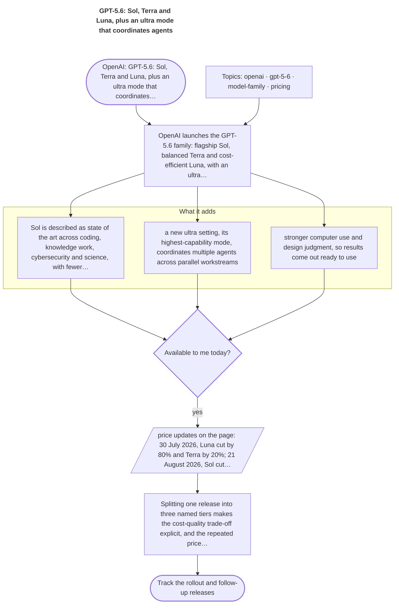

## What happened

On 9 July 2026 **OpenAI** launched the **GPT-5.6** family for general availability after a limited preview: **Sol**, the new flagship, **Terra**, a balanced model for everyday work, and **Luna**, the most cost-efficient.

## The technical details

From the OpenAI post:

- Sol is described as state of the art across **coding, knowledge work, cybersecurity and science**, with **fewer tokens and lower estimated cost**, so more successful work per dollar
- a new **ultra** setting, its highest-capability mode, **coordinates multiple agents across parallel workstreams**
- stronger **computer use and design judgment**, so results come out ready to use
- **price updates on the page:** 30 July 2026, Luna cut by 80% and Terra by 20%; 21 August 2026, Sol cut by over 20% for three months

## How it fits together

The flowchart below maps this announcement's main points and what depends on them.

## Why it matters

Splitting one release into three named tiers makes the cost-quality trade-off explicit, and the repeated price cuts show how fast per-token pricing was moving in 2026. The emphasis on performance per dollar, not only peak score, is the theme of this family.
