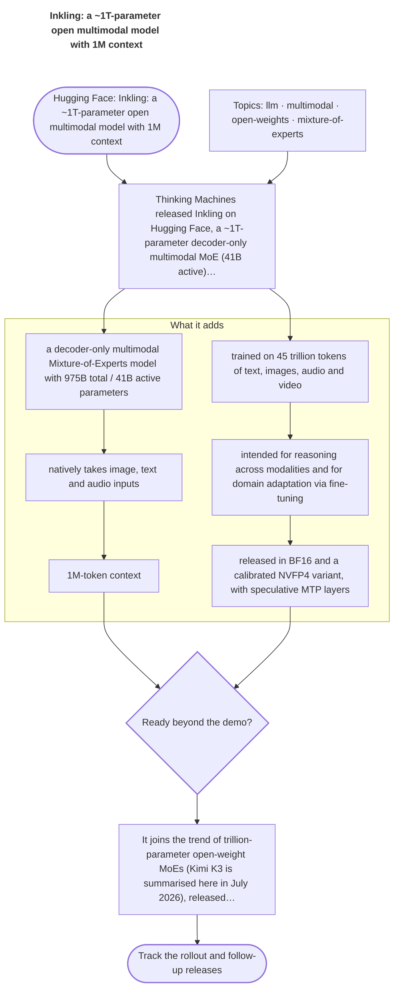

## What happened

**Thinking Machines Lab** released **Inkling** on Hugging Face, with day-zero support in Transformers, SGLang, vLLM and llama.cpp. A later update added **Inkling-Small**.

## The technical details

From the Hugging Face post:

- a **decoder-only multimodal Mixture-of-Experts** model with **975B total / 41B active** parameters
- natively takes **image, text and audio** inputs
- **1M-token** context
- trained on **45 trillion tokens** of text, images, audio and video
- intended for reasoning across modalities and for **domain adaptation via fine-tuning**
- released in **BF16** and a calibrated **NVFP4** variant, with **speculative MTP layers**
- **Inkling-Small**: 276B total / 12B active, same architecture, with MXFP8 and NVFP4 weights

## How it fits together

The flowchart below maps this announcement's main points and what depends on them.

## Why it matters

It joins the trend of trillion-parameter open-weight MoEs (Kimi K3 is summarised here in July 2026), released already quantised, because that's the only practical way most people can run them.
