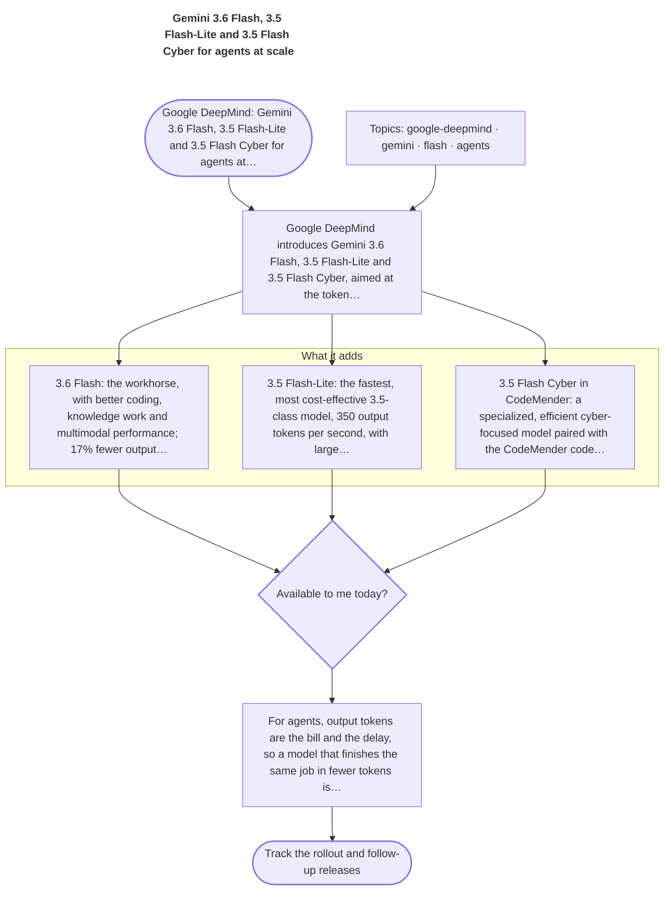

## What happened

On 21 July 2026 **Google DeepMind** introduced three Gemini models built on Gemini 3.5 Flash, for developers and customers building production agents that need higher token efficiency, lower latency and more reliable performance.

## The technical details

From the Google DeepMind post:

- **3.6 Flash:** the workhorse, with better coding, knowledge work and multimodal performance; **17% fewer output tokens** than 3.5 Flash (Artificial Analysis Index) and up to **65%** on **DeepSWE by Datacurve**, at a lower cost per output token
- **3.5 Flash-Lite:** the fastest, most cost-effective 3.5-class model, **350 output tokens per second**, with large gains over earlier Flash-Lite generations in agentic workflows
- **3.5 Flash Cyber in CodeMender:** a specialized, efficient cyber-focused model paired with the **CodeMender** code security agent, positioned as competitive at the frontier

## How it fits together

The flowchart below maps this announcement's main points and what depends on them.

## Why it matters

For agents, output tokens are the bill and the delay, so a model that finishes the same job in fewer tokens is cheaper and faster at once. The pairing of a cyber model with an agent, rather than a model alone, reflects that security work depends on the orchestration around the model.
