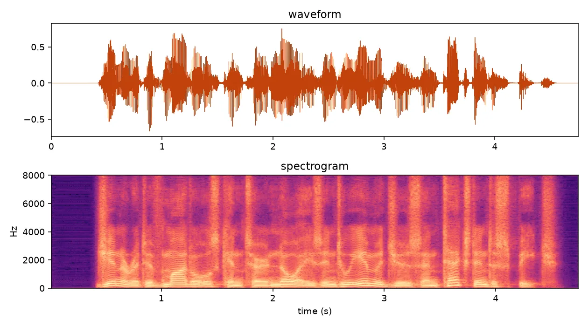

The last generative topic is audio. Classic text-to-speech was two stages: a model predicts a **spectrogram** from text, then a **vocoder** turns it into a waveform. **VITS** (Kim, Kong and Son, 2021) does it end to end, combining ideas from this phase: a **VAE**, **normalising flows** and **adversarial (GAN) training**, plus a stochastic duration predictor so the same text can be spoken with natural variation.

Meta's **MMS** project (Pratap et al., 2023) trained VITS-based TTS models for over 1,000 languages. I ran the small English one (`facebook/mms-tts-eng`) through `transformers`, then plotted the waveform and spectrogram of the generated speech. The audio itself is attached below the figure.

```python run
import os, numpy as np, torch, scipy.io.wavfile as wavfile
import matplotlib.pyplot as plt
from transformers import VitsModel, AutoTokenizer
torch.manual_seed(0)

name = "facebook/mms-tts-eng"
model, tok = VitsModel.from_pretrained(name).eval(), AutoTokenizer.from_pretrained(name)
text = "Generative models can turn noise into images and text into speech."
with torch.no_grad():
    wav = model(**tok(text, return_tensors="pt")).waveform[0].numpy()
sr = model.config.sampling_rate
print(f"sampling rate {sr} Hz | samples {len(wav):,} | duration {len(wav) / sr:.2f} s | parameters {sum(p.numel() for p in model.parameters()) / 1e6:.1f}M")

out_dir = os.path.join(os.path.dirname(os.environ["SNIPPET_FIG"]), "..", "public", "audio", "2026")
os.makedirs(out_dir, exist_ok=True)
wavfile.write(os.path.join(out_dir, "genai-08-tts.wav"), sr, (wav / np.abs(wav).max() * 32767 * 0.9).astype(np.int16))

fig, axs = plt.subplots(2, 1, figsize=(9, 5), dpi=140)
t = np.arange(len(wav)) / sr
axs[0].plot(t, wav, lw=0.4, color="#c2410c"); axs[0].set_title("waveform"); axs[0].set_xlim(0, t[-1])
axs[1].specgram(wav, NFFT=512, Fs=sr, noverlap=384, cmap="magma"); axs[1].set_title("spectrogram"); axs[1].set_xlabel("time (s)"); axs[1].set_ylabel("Hz")
fig.tight_layout(); fig.savefig(os.environ["SNIPPET_FIG"])
```

Output:

```text
sampling rate 16000 Hz | samples 76,032 | duration 4.75 s | parameters 36.3M
```



<audio controls preload="none" src="/audio/2026/genai-08-tts.wav">Your browser does not support audio playback.</audio>

That completes generative AI. The final phase, agentic AI, starts in August.
