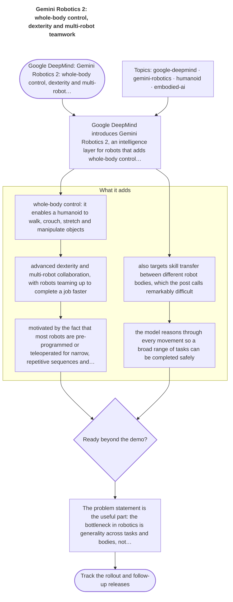

## What happened

On 28 July 2026 **Google DeepMind** introduced **Gemini Robotics 2**, described as the intelligence layer powering the next generation of adaptable robots, from feet to fingertips. It builds on the original Gemini Robotics, which showed Gemini's multimodal understanding driving real-world action.

## The technical details

From the Google DeepMind post:

- **whole-body control**: it enables a humanoid to walk, crouch, stretch and manipulate objects
- **advanced dexterity** and **multi-robot collaboration**, with robots teaming up to complete a job faster
- motivated by the fact that most robots are **pre-programmed or teleoperated** for narrow, repetitive sequences and cannot adapt to unpredictable environments
- also targets **skill transfer between different robot bodies**, which the post calls remarkably difficult
- the model reasons through every movement so a broad range of tasks can be completed safely

## How it fits together

The flowchart below maps this announcement's main points and what depends on them.

## Why it matters

The problem statement is the useful part: the bottleneck in robotics is generality across tasks and bodies, not any single skill. A shared intelligence layer that transfers between embodiments is the approach being tested.
