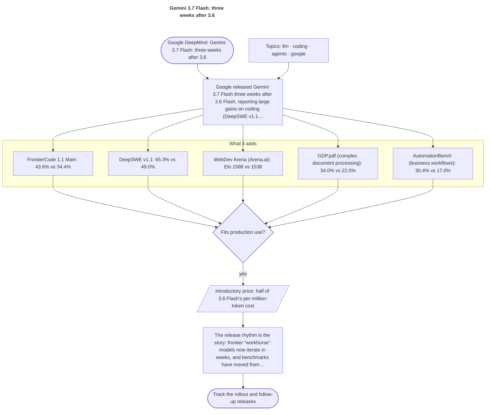

## What happened

Google released **Gemini 3.7 Flash**, described as its most intelligent "workhorse" model for coding and agents, just **three weeks** after Gemini 3.6 Flash.

## The technical details

From the post, comparing 3.7 Flash with 3.6 Flash:

- **FrontierCode 1.1 Main**: 43.6% vs 34.4%
- **DeepSWE v1.1**: 65.3% vs 49.0%
- **WebDev Arena** (Arena.ai): Elo 1588 vs 1538
- **GDP.pdf** (complex document processing): 34.0% vs 22.0%
- **AutomationBench** (business workflows): 30.4% vs 17.0%
- introductory price: **half** of 3.6 Flash's per-million-token cost

## How it fits together

The flowchart below maps this announcement's main points and what depends on them.

## Why it matters

The release rhythm is the story: frontier "workhorse" models now iterate in weeks, and benchmarks have moved from short coding puzzles to issue resolution, web apps and real document workflows.
