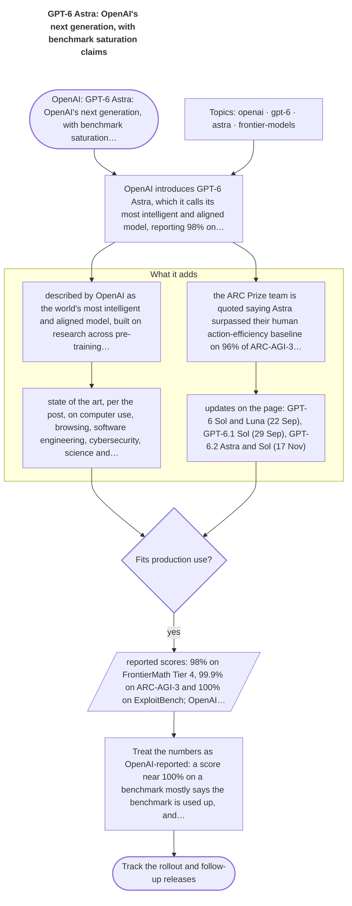

## What happened

On 3 September 2026 **OpenAI** introduced **GPT-6 Astra**, rolling out first to a limited set of organizations and then, over the following days, to ChatGPT Plus, Pro, Business and Enterprise users, the OpenAI API, Microsoft Azure and AWS Bedrock.

## The technical details

From the OpenAI post:

- described by OpenAI as the world's most intelligent and aligned model, built on research across **pre-training, reinforcement learning and alignment**
- state of the art, per the post, on **computer use, browsing, software engineering, cybersecurity, science and professional work**
- reported scores: **98% on FrontierMath Tier 4**, **99.9% on ARC-AGI-3** and **100% on ExploitBench**; OpenAI also says it has helped solve long-standing open problems in mathematics
- the ARC Prize team is quoted saying Astra surpassed their human action-efficiency baseline on **96% of ARC-AGI-3 levels**, effectively reaching human parity
- **updates on the page:** GPT-6 Sol and Luna (22 Sep), GPT-6.1 Sol (29 Sep), GPT-6.2 Astra and Sol (17 Nov)

## How it fits together

The flowchart below maps this announcement's main points and what depends on them.

## Why it matters

Treat the numbers as OpenAI-reported: a score near 100% on a benchmark mostly says the benchmark is used up, and the post itself uses the word saturates. What is more informative is the speed of iteration shown in the update list, with three further releases in under three months.
