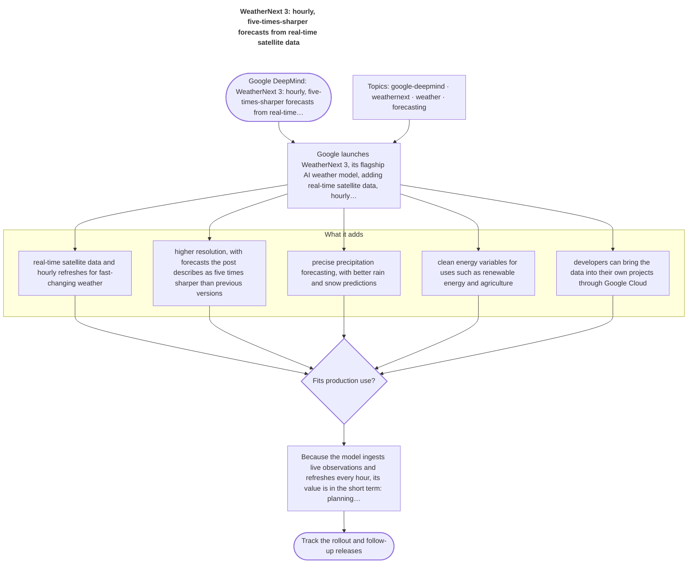

## What happened

On 3 September 2026 **Google DeepMind** introduced **WeatherNext 3**, its most advanced and accurate global weather AI model. The forecasts are integrated across Google Search, Gemini, Maps, Google Maps Platform and Google Cloud.

## The technical details

From the Google DeepMind post:

- **real-time satellite data** and **hourly refreshes** for fast-changing weather
- **higher resolution**, with forecasts the post describes as five times sharper than previous versions
- **precise precipitation forecasting**, with better rain and snow predictions
- **clean energy variables** for uses such as renewable energy and agriculture
- developers can bring the data into their own projects through **Google Cloud**

## How it fits together

The flowchart below maps this announcement's main points and what depends on them.

## Why it matters

Because the model ingests live observations and refreshes every hour, its value is in the short term: planning around rain, snow or solar and wind output. The reach through Search, Maps and Gemini is what puts it in front of everyday users.
