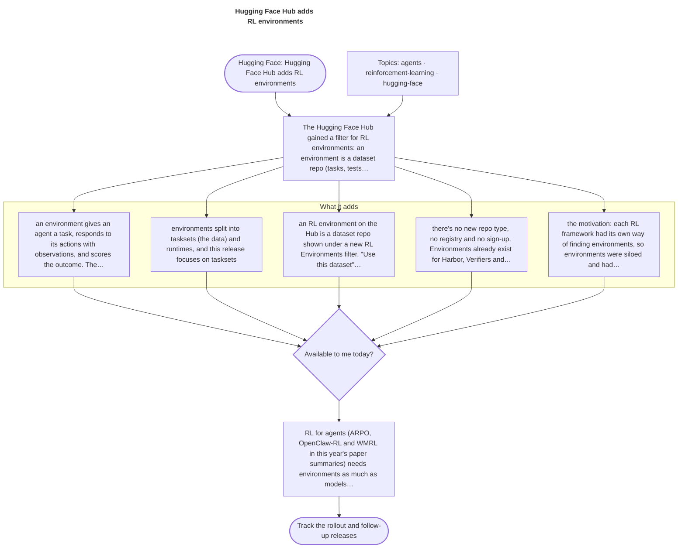

## What happened

The Hugging Face Hub added a dedicated place for **reinforcement-learning environments** for agents.

## The technical details

From the post:

- an environment gives an agent a **task**, responds to its actions with **observations**, and **scores** the outcome. The rewards can serve as evaluation or as a training signal.
- environments split into **tasksets** (the data) and **runtimes**, and this release focuses on tasksets
- an RL environment on the Hub is a **dataset repo** shown under a new **RL Environments filter**. "Use this dataset" gives the command to run it in a supported framework.
- there's no new repo type, no registry and no sign-up. Environments already exist for **Harbor**, **Verifiers** and **NVIDIA NeMo Gym**.
- the motivation: each RL framework had its own way of finding environments, so environments were siloed and had to be ported by hand

## How it fits together

The flowchart below maps this announcement's main points and what depends on them.

## Why it matters

RL for agents (ARPO, OpenClaw-RL and WMRL in this year's paper summaries) needs environments as much as models need data. Treating them as versioned datasets makes them shareable across frameworks.
