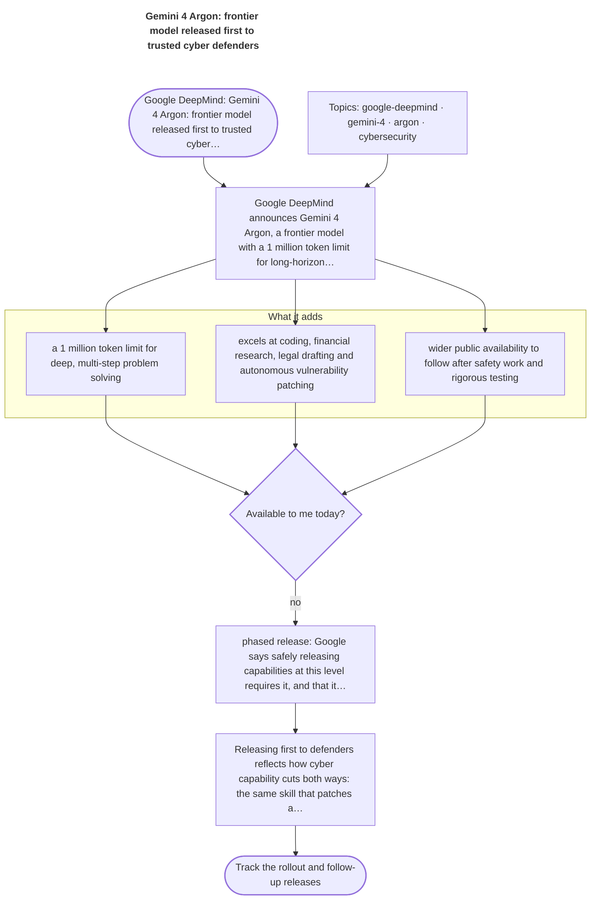

## What happened

On 30 September 2026 **Google DeepMind** announced **Gemini 4 Argon**, its new frontier model, built to sustain deep reasoning across complex, long-horizon workflows. It started rolling out to trusted cyber defenders through the **Fairwind Program**.

## The technical details

From the Google DeepMind post:

- a **1 million token** limit for deep, multi-step problem solving
- excels at **coding, financial research, legal drafting and autonomous vulnerability patching**
- **phased release**: Google says safely releasing capabilities at this level requires it, and that it is engaged in the **U.S. government's voluntary process for pre-release model access**
- wider public availability to follow after safety work and rigorous testing

## How it fits together

The flowchart below maps this announcement's main points and what depends on them.

## Why it matters

Releasing first to defenders reflects how cyber capability cuts both ways: the same skill that patches a vulnerability can find one. Argon's two-week successor, Gemini 4 Carbon, shows how quickly this tier was moving.
