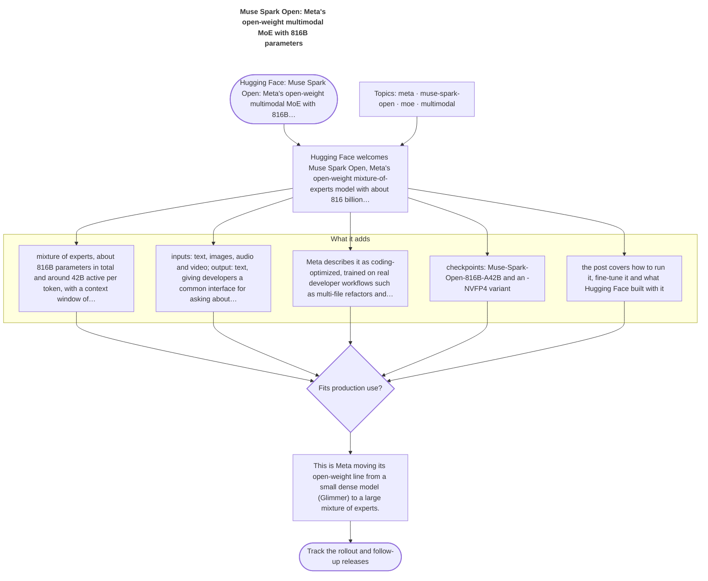

## What happened

On 15 October 2026 **Hugging Face** published its guide to **Muse Spark Open**, an open-weight model from **Meta**, following the smaller dense Muse Glimmer released in August.

## The technical details

From the Hugging Face post:

- **mixture of experts**, about **816B parameters in total and around 42B active per token**, with a context window of up to **1 million tokens**
- inputs: **text, images, audio and video**; output: text, giving developers a common interface for asking about different kinds of input
- Meta describes it as **coding-optimized**, trained on real developer workflows such as multi-file refactors and long debugging sessions, and **agentic**: it plans, acts, observes and self-corrects over long tasks, including browsing the web with images
- checkpoints: `Muse-Spark-Open-816B-A42B` and an `-NVFP4` variant
- the post covers how to run it, fine-tune it and what Hugging Face built with it

## How it fits together

The flowchart below maps this announcement's main points and what depends on them.

## Why it matters

This is Meta moving its open-weight line from a small dense model (Glimmer) to a large mixture of experts. The claim of being the most capable US open-weights model is Hugging Face's wording and depends on which models are compared.
