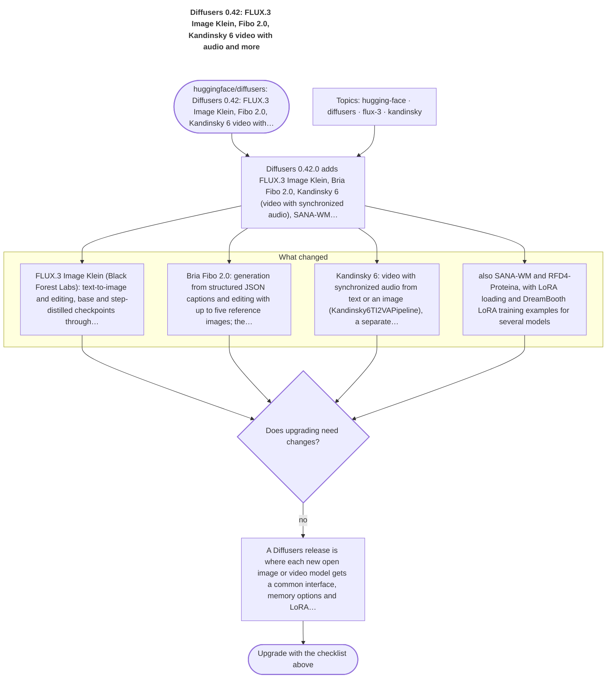

## What happened

On 23 October 2026 **Hugging Face** released **Diffusers 0.42.0**, bringing several new pipelines along with adapter support, hardware integrations and modular pipelines. Python 3.11 or newer is now required.

## The technical details

From the release notes:

- **FLUX.3 Image Klein** (Black Forest Labs): text-to-image and editing, base and step-distilled checkpoints through `ModularPipeline`, a built-in **prompt upsampler** that turns short requests into detailed captions (including layout with bounding boxes), and FP8r and NVFP4 checkpoints
- **Bria Fibo 2.0:** generation from **structured JSON captions** and editing with up to **five reference images**; the edit-turbo checkpoint runs in **four steps** without classifier-free guidance
- **Kandinsky 6:** **video with synchronized audio** from text or an image (`Kandinsky6TI2VAPipeline`), a separate `Kandinsky6SRPipeline` for **video super-resolution**, and `PiflowScheduler` for distilled models
- also **SANA-WM** and **RFD4-Proteina**, with LoRA loading and DreamBooth LoRA training examples for several models

## How it fits together

The flowchart below maps this announcement's main points and what depends on them.

## Why it matters

A Diffusers release is where each new open image or video model gets a common interface, memory options and LoRA training. The mix here, from structured-caption image models to audio-synchronized video, shows how broad the open generative stack has become.
