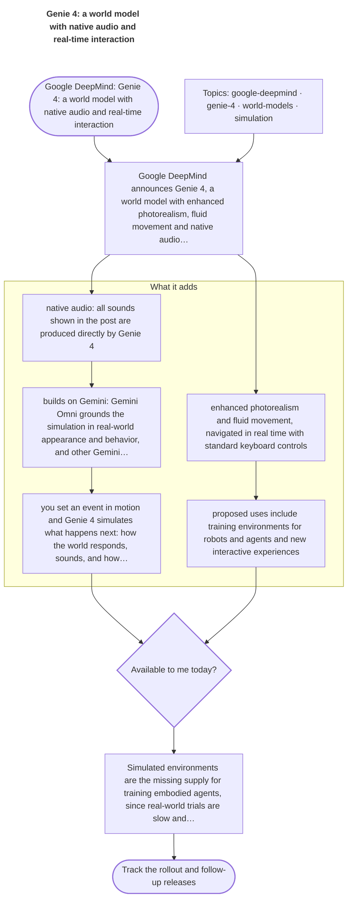

## What happened

On 27 October 2026 **Google DeepMind** announced **Genie 4**, a new world model that unlocks greater realism and improves real-time interactive simulation. The post is by Raia Hadsell, Diego Rivas and Hang Qi.

## The technical details

From the Google DeepMind post:

- **native audio**: all sounds shown in the post are produced directly by Genie 4
- **builds on Gemini**: Gemini Omni grounds the simulation in real-world appearance and behavior, and other Gemini models provide the reasoning to keep it coherent
- you set an event in motion and Genie 4 simulates what happens next: **how the world responds, sounds, and how people move, react and speak**
- enhanced **photorealism and fluid movement**, navigated in real time with standard keyboard controls
- proposed uses include **training environments for robots and agents** and new interactive experiences

## How it fits together

The flowchart below maps this announcement's main points and what depends on them.

## Why it matters

Simulated environments are the missing supply for training embodied agents, since real-world trials are slow and unsafe. Adding sound and dialogue moves Genie from a visual simulator toward a full environment.
