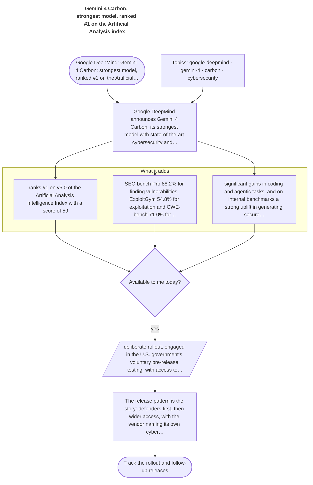

## What happened

On 28 October 2026 **Google DeepMind** announced **Gemini 4 Carbon**, its next frontier model, two weeks after Gemini 4 Argon. It is described as Google's strongest model, with state-of-the-art cybersecurity and long-horizon capabilities.

## The technical details

From the Google DeepMind post:

- ranks **#1 on v5.0 of the Artificial Analysis Intelligence Index with a score of 59**
- **SEC-bench Pro 88.2%** for finding vulnerabilities, **ExploitGym 54.8%** for exploitation and **CWE-bench 71.0%** for patching
- significant gains in coding and agentic tasks, and on internal benchmarks a strong uplift in **generating secure code**; in live coding environments, **reduced misalignment and fabrication rates**
- **deliberate rollout**: engaged in the U.S. government's voluntary pre-release testing, with access to a subset of cyber defenders that week and gradual expansion to more trusted groups

## How it fits together

The flowchart below maps this announcement's main points and what depends on them.

## Why it matters

The release pattern is the story: defenders first, then wider access, with the vendor naming its own cyber benchmarks and a government testing process. Two frontier models in two weeks also shows how short the gap between releases had become.
