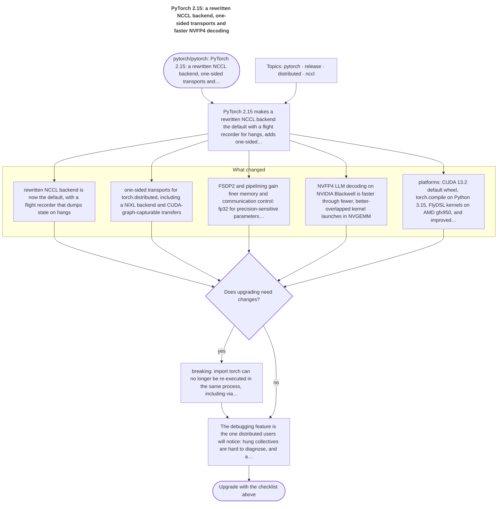

## What happened

On 28 October 2026 the **PyTorch** team released **2.15.0**, a release focused on distributed training and low-precision inference.

## The technical details

From the release notes:

- **rewritten NCCL backend** is now the default, with a **flight recorder** that dumps state on hangs
- **one-sided transports** for `torch.distributed`, including a **NIXL** backend and CUDA-graph-capturable transfers
- **FSDP2 and pipelining** gain finer memory and communication control: fp32 for precision-sensitive parameters, CUDA-graph-captured gradient accumulation and gradient reduction overlapped with compute
- **NVFP4 LLM decoding on NVIDIA Blackwell** is faster through fewer, better-overlapped kernel launches in NVGEMM
- **platforms:** CUDA 13.2 default wheel, `torch.compile` on Python 3.15, FlyDSL kernels on AMD gfx950, and improved Intel GPU profiling
- breaking: `import torch` can no longer be re-executed in the same process, including via `importlib.reload`

## How it fits together

The flowchart below maps this announcement's main points and what depends on them.

## Why it matters

The debugging feature is the one distributed users will notice: hung collectives are hard to diagnose, and a built-in flight recorder shows what each rank was doing. The 4-bit and FP8 work reflects where LLM inference was heading by late 2026.
