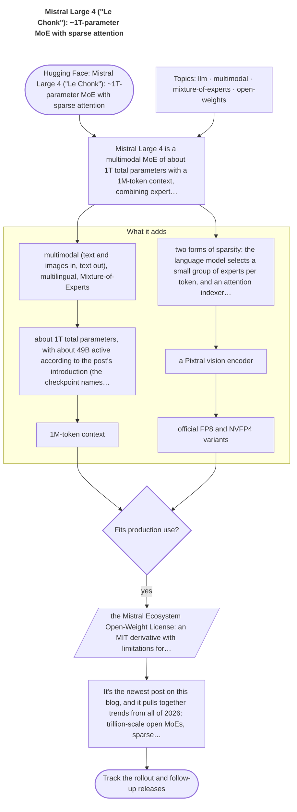

## What happened

**Mistral** released **Mistral Large 4**, nicknamed "Le Chonk", with Hugging Face support in Transformers, vLLM and llama.cpp (GGUFs by Unsloth and the llama.cpp team), TRL fine-tuning, and Inference Endpoints. The post was published on 29 October 2026.

## The technical details

From the Hugging Face post:

- **multimodal** (text and images in, text out), **multilingual**, **Mixture-of-Experts**
- about **1T total parameters**, with about **49B active** according to the post's introduction (the checkpoint names use "A52B")
- **1M-token** context
- **two forms of sparsity**: the language model selects a small group of **experts** per token, and an **attention indexer** selects which earlier positions to attend to
- a **Pixtral** vision encoder
- official **FP8** and **NVFP4** variants
- the **Mistral Ecosystem Open-Weight License**: an MIT derivative with limitations for model-as-a-service offerings
- the post highlights strength in **cybersecurity**, **coding agents** and multimodality

## How it fits together

The flowchart below maps this announcement's main points and what depends on them.

## Why it matters

It's the newest post on this blog, and it pulls together trends from all of 2026: trillion-scale open MoEs, sparse attention (like DeepSeek Sparse Attention in GLM-5) and releases already in 4-bit formats. It's also a reminder that "open weights" covers very different licences, so they're worth reading.
