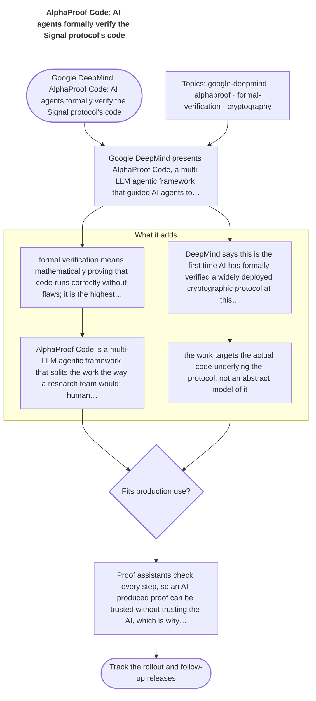

## What happened

On 10 November 2026 **Google DeepMind** (Pushmeet Kohli and Swarat Chaudhuri) shared **AlphaProof Code**, a new agentic framework for formal verification. Researchers used it to prove key security properties of the real code behind the **Signal protocol**, which protects conversations in apps such as Signal and Google Messages.

## The technical details

From the Google DeepMind post:

- **formal verification** means mathematically proving that code runs correctly without flaws; it is the highest standard of security assurance but is difficult and labor-intensive
- AlphaProof Code is a **multi-LLM agentic framework** that splits the work the way a research team would: **human experts work with AI to decide what to prove**, and **a group of AI agents does the proving**
- DeepMind says this is the **first time AI has formally verified a widely deployed cryptographic protocol at this depth**, and the first time the implementation of such a protocol has been verified by any method
- the work targets the **actual code** underlying the protocol, not an abstract model of it

## How it fits together

The flowchart below maps this announcement's main points and what depends on them.

## Why it matters

Proof assistants check every step, so an AI-produced proof can be trusted without trusting the AI, which is why formal verification is a natural fit for agents. The caveat the post itself makes is that humans still choose what is worth proving.
