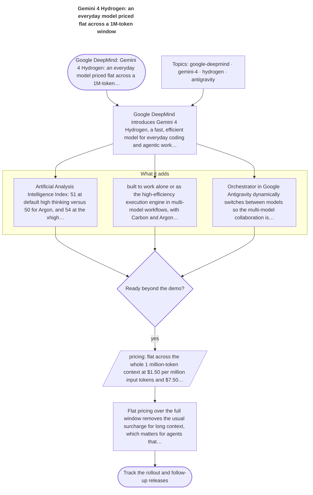

## What happened

On 12 November 2026 **Google DeepMind** introduced **Gemini 4 Hydrogen**, bringing frontier-class intelligence to everyday coding and agentic workflows with speed and efficiency. The page was last updated on 16 November.

## The technical details

From the Google DeepMind post:

- **Artificial Analysis Intelligence Index:** 51 at default high thinking versus 50 for Argon, and 54 at the **xhigh** thinking setting
- **pricing:** flat across the whole **1 million-token** context at **$1.50 per million input tokens and $7.50 per million output tokens**
- built to work alone or as the **high-efficiency execution engine** in multi-model workflows, with Carbon and Argon handling deep architectural judgment
- **Orchestrator in Google Antigravity** dynamically switches between models so the multi-model collaboration is automatic

## How it fits together

The flowchart below maps this announcement's main points and what depends on them.

## Why it matters

Flat pricing over the full window removes the usual surcharge for long context, which matters for agents that carry large histories. The multi-model framing (a strong model plans, a fast one executes) is becoming a standard way to control cost.
