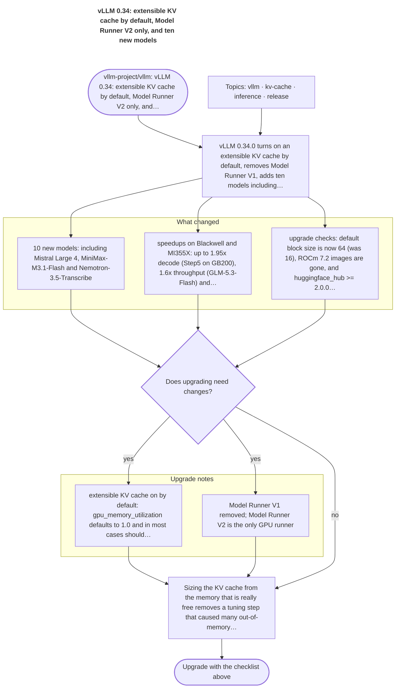

## What happened

On 16 November 2026 the **vLLM** project released **v0.34.0**.

## The technical details

From the release notes:

- **10 new models:** including Mistral Large 4, MiniMax-M3.1-Flash and Nemotron-3.5-Transcribe
- **extensible KV cache on by default:** `gpu_memory_utilization` defaults to 1.0 and in most cases should no longer be set; use it only to share a GPU or when the extensible cache is disabled
- **Model Runner V1 removed**; Model Runner V2 is the only GPU runner
- **speedups** on Blackwell and MI355X: up to **1.95x decode** (Step5 on GB200), **1.6x throughput** (GLM-5.3-Flash) and **1.24 to 1.40x faster long-prompt time to first token** (GLM-5.3)
- **upgrade checks:** default block size is now **64** (was 16), ROCm 7.2 images are gone, and `huggingface_hub >= 2.0.0` is required

## How it fits together

The flowchart below maps this announcement's main points and what depends on them.

## Why it matters

Sizing the KV cache from the memory that is really free removes a tuning step that caused many out-of-memory errors or wasted memory. The list of breaking changes at the top of the notes is a model of how to make upgrades safe.
