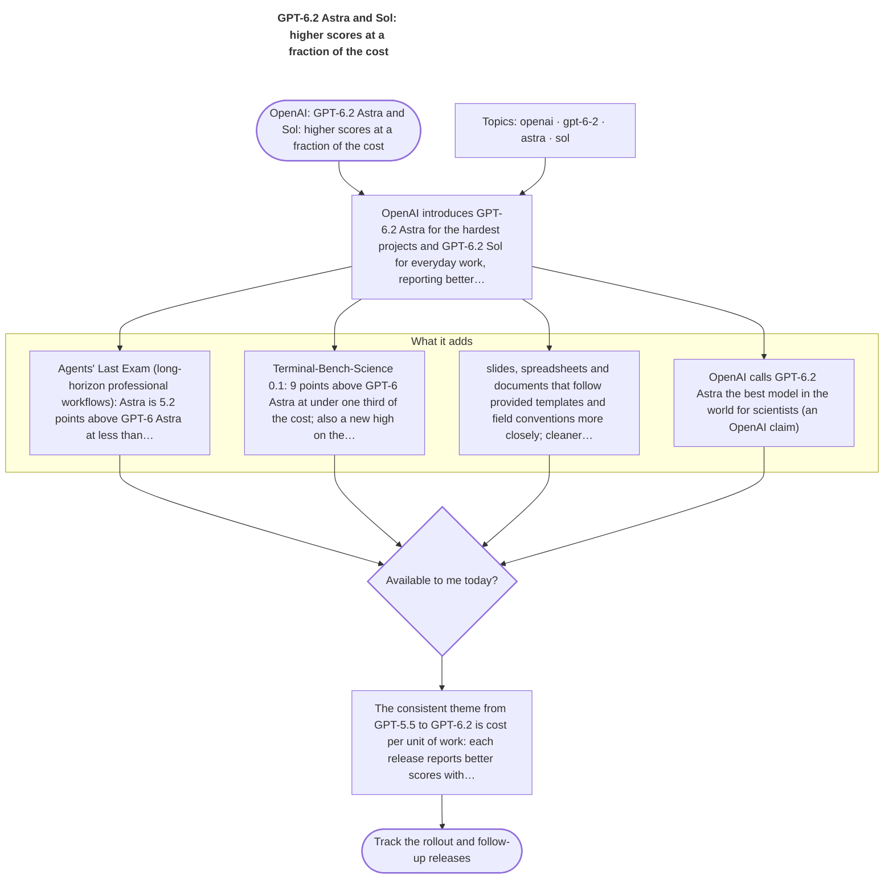

## What happened

On 17 November 2026 **OpenAI** introduced **GPT-6.2 Astra**, its frontier model for the hardest projects, and **GPT-6.2 Sol**, an efficient, versatile model for everyday work. Both are pitched as delivering better results on demanding tasks with fewer output tokens.

## The technical details

From the OpenAI post:

- **Agents' Last Exam** (long-horizon professional workflows): Astra is **5.2 points above GPT-6 Astra at less than one third of the cost**, and, per OpenAI, 5.5 points ahead of Claude Fable 5.2 at 5% of the cost; OpenAI notes Fable 5.2's leaderboard result excludes nine tasks that used a fallback model
- **Terminal-Bench-Science 0.1:** 9 points above GPT-6 Astra at under one third of the cost; also a new high on the Vals Science Index
- slides, spreadsheets and documents that follow provided templates and field conventions more closely; cleaner code and better-looking frontends, especially for websites, games and 3D design
- OpenAI calls GPT-6.2 Astra the best model in the world for scientists (an OpenAI claim)

## How it fits together

The flowchart below maps this announcement's main points and what depends on them.

## Why it matters

The consistent theme from GPT-5.5 to GPT-6.2 is cost per unit of work: each release reports better scores with fewer tokens. Competitor comparisons here are OpenAI's own, and the footnote about excluded tasks is a good example of why leaderboard methodology should be read.
