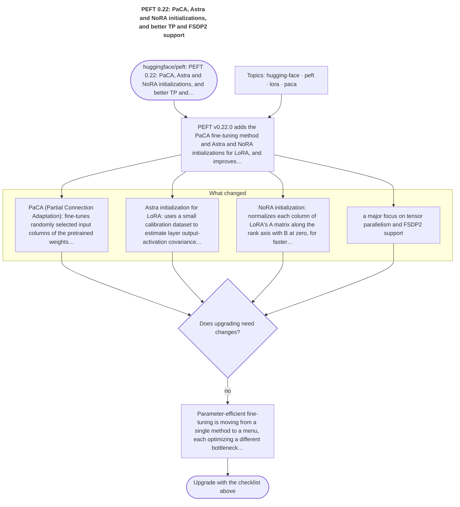

## What happened

On 19 November 2026 **Hugging Face** released **PEFT v0.22.0**, adding new methods and focusing on better distributed training support.

## The technical details

From the release notes:

- **PaCA (Partial Connection Adaptation):** fine-tunes randomly selected input columns of the pretrained weights instead of adding adapter layers, removing sequential adapter computation; per the ICLR 2025 paper it gives **22% less training time, 16% less memory and 23% longer sequences** with comparable accuracy, and it supports only `nn.Linear` layers
- **Astra initialization for LoRA:** uses a small calibration dataset to estimate layer output-activation covariance and initializes LoRA in the **lowest-variance directions** (`init_lora_weights="astra"`)
- **NoRA initialization:** normalizes each column of LoRA's A matrix along the rank axis with B at zero, for faster and better convergence; set `lora_alpha` equal to the rank
- a major focus on **tensor parallelism and FSDP2** support

## How it fits together

The flowchart below maps this announcement's main points and what depends on them.

## Why it matters

Parameter-efficient fine-tuning is moving from a single method to a menu, each optimizing a different bottleneck: memory, speed or convergence. PaCA's own caveat, that it is less effective when only light modules are adapted, is the useful guidance.
