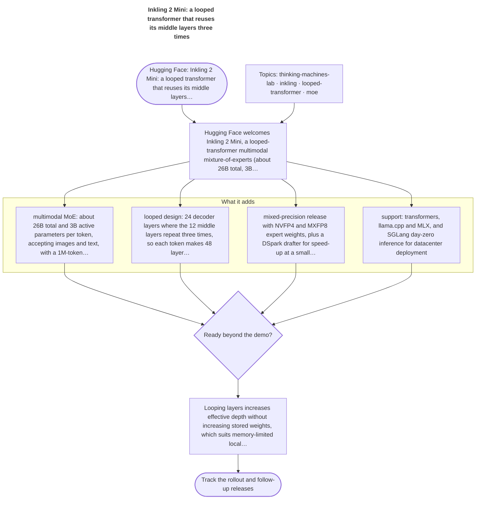

## What happened

On 20 November 2026 **Hugging Face** published its guide to **Inkling 2 Mini** from **Thinking Machines Lab**, a small model designed for local AI setups. In Hugging Face's vibe tests it was at least comparable with Qwen 3.8 27B, though the post says more validation is needed.

## The technical details

From the Hugging Face post:

- **multimodal MoE:** about **26B total and 3B active parameters per token**, accepting images and text, with a **1M-token context**
- **looped design:** 24 decoder layers where the **12 middle layers repeat three times**, so each token makes 48 layer visits with half the physical layers; hidden size is 2,304 versus 4,608 in Inkling 2 Small
- **mixed-precision release** with **NVFP4 and MXFP8 expert weights**, plus a **DSpark drafter** for speed-up at a small memory cost
- support: **transformers, llama.cpp and MLX**, and **SGLang** day-zero inference for datacenter deployment

## How it fits together

The flowchart below maps this announcement's main points and what depends on them.

## Why it matters

Looping layers increases effective depth without increasing stored weights, which suits memory-limited local hardware. It is a different route to capacity than adding experts, and the 48-visit count is what to compare against ordinary models.
