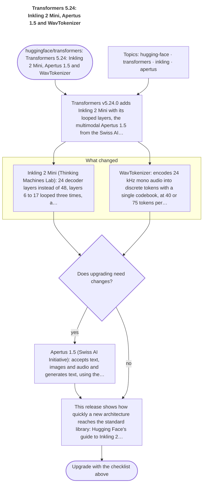

## What happened

On 21 November 2026 **Hugging Face** released **Transformers v5.24.0**, adding three new model families.

## The technical details

From the release notes:

- **Inkling 2 Mini** (Thinking Machines Lab): 24 decoder layers instead of 48, **layers 6 to 17 looped three times**, a **learned message-passing mechanism** mixing the previous pass's residuals into each loop layer's attention and MoE inputs, hidden size 2304, **8 of 128 experts** per token; a research checkpoint supports a **variable number of loop passes** (fewer is faster, more improves quality); NVFP4 and MXFP8 layers are dequantized at load time
- **Apertus 1.5** (Swiss AI Initiative): accepts **text, images and audio** and generates text, using the **EMU3.5** vision tokenizer and **WavTokenizer** for audio; image and audio generation are not supported
- **WavTokenizer:** encodes **24 kHz mono audio into discrete tokens** with a single codebook, at 40 or 75 tokens per second depending on the checkpoint

## How it fits together

The flowchart below maps this announcement's main points and what depends on them.

## Why it matters

This release shows how quickly a new architecture reaches the standard library: Hugging Face's guide to Inkling 2 Mini appeared on 20 November and its model code shipped the next day, with the looping mechanism documented. The variable-pass research checkpoint is a direct way to trade quality for speed at inference.
