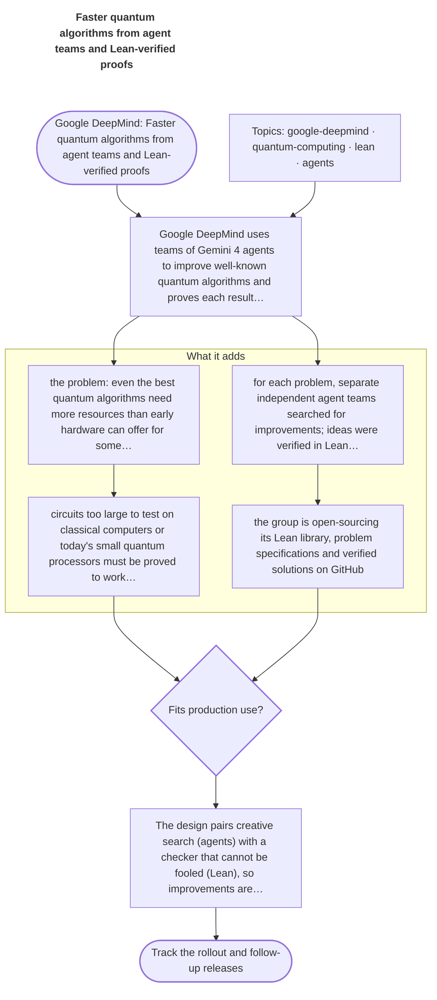

## What happened

On 23 November 2026 **Google DeepMind** (Sergey Shirobokov, Ben Jaderberg and Ryan Babbush) described a paper in which teams of **Gemini 4 agents** improved well-known quantum algorithms, producing highly efficient quantum circuits that could one day support simulations from fusion energy to drug design and enzymes.

## The technical details

From the Google DeepMind post:

- the problem: even the best quantum algorithms need more resources than early hardware can offer for some important applications
- circuits too large to test on classical computers or today's small quantum processors must be **proved to work mathematically**, so every result was proved in **Lean**, a formal theorem prover
- for each problem, **separate independent agent teams** searched for improvements; ideas were **verified in Lean** before entering a **shared notebook**
- the group is **open-sourcing its Lean library, problem specifications and verified solutions** on GitHub

## How it fits together

The flowchart below maps this announcement's main points and what depends on them.

## Why it matters

The design pairs creative search (agents) with a checker that cannot be fooled (Lean), so improvements are trustworthy even for circuits nobody can run yet. It is the same pattern as AlphaProof Code, applied to quantum resources.
